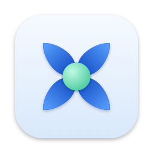
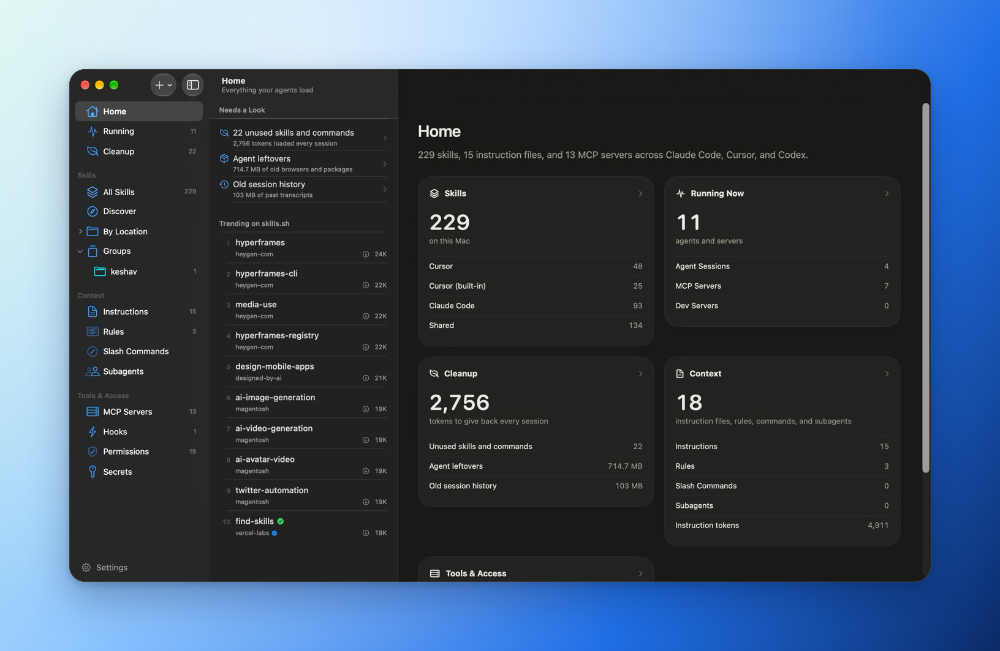
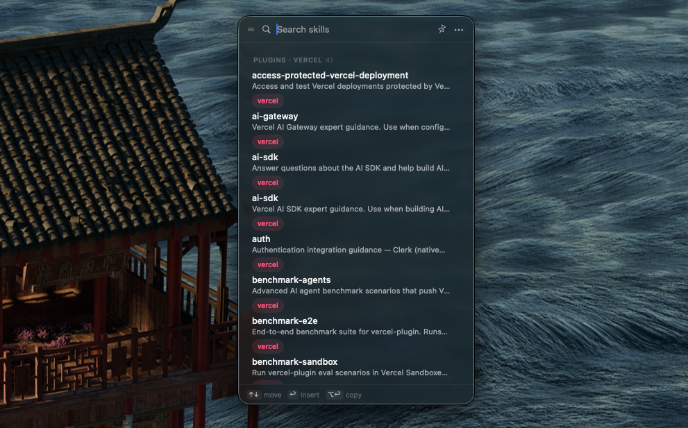
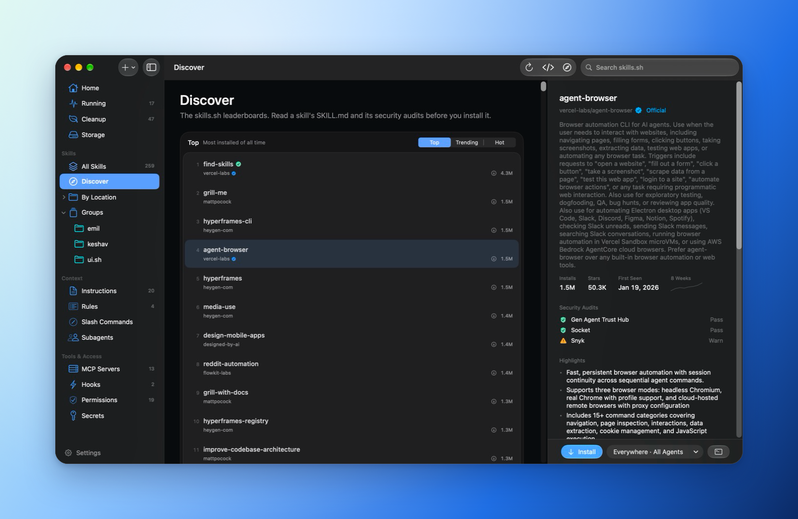
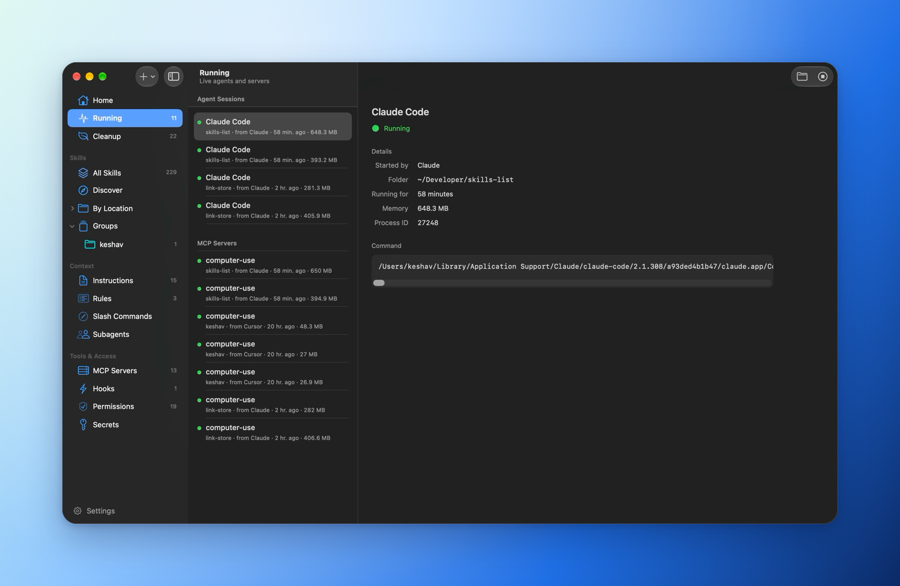
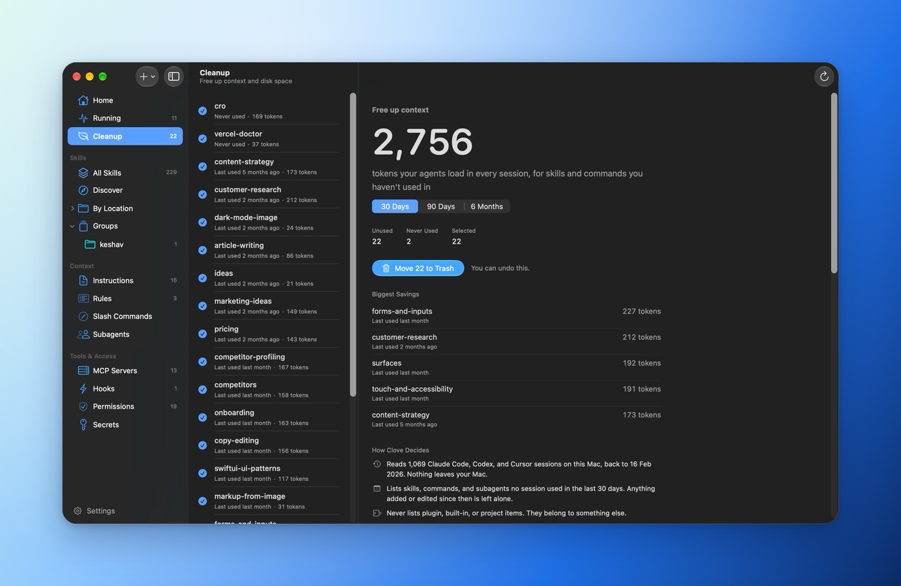
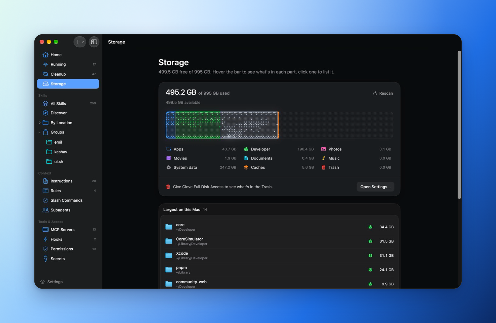
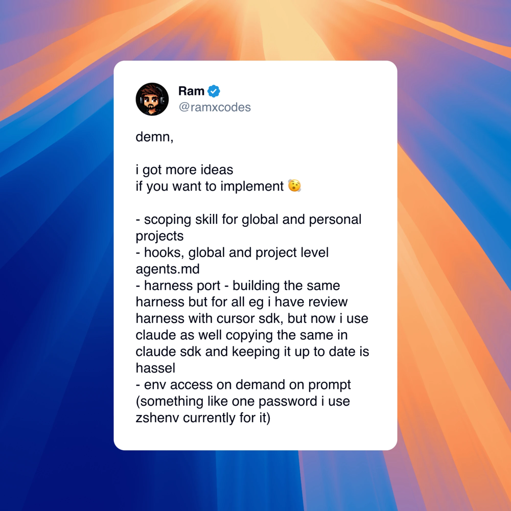

<div align="center">



# Clove

**Everything your AI agents load, in one native Mac app.**

Skills, instruction files, rules, commands, subagents, MCP servers, hooks, permissions, and the API keys they need, across Claude Code, Cursor, and Codex. Find new skills on [skills.sh](https://skills.sh), see what each agent is set up with, clean out what you don't use, and see what's filling your disk.

```bash
curl -fsSL https://github.com/keshav-exe/clove/releases/latest/download/install.sh | bash
```

[**Download for Mac**](https://github.com/keshav-exe/clove/releases/latest) · [Website](https://clove.kshv.me) · [What's new in 3.1](https://github.com/keshav-exe/clove/releases/tag/v3.1)

Open source · MIT · Lifetime license for the signed app · No account · macOS 26



</div>

## Home

One page with what needs a look right now: skills you never use, leftovers agents downloaded and forgot, old session history, keys sitting in plain text. Trending skills from skills.sh sit beside it, one click from their page.

## Quick access panel



Skills live in `~/.cursor`, `~/.claude`, plugins, and project folders. Clove finds every `SKILL.md` on your Mac, including skills linked in from a dotfiles repo, and puts them one shortcut away.

- Search names, descriptions, and groups
- Copy prompt-ready references like `/animations` or `@nextjs`, not file paths
- Pin the panel beside your editor (`⌘⇧K`), or drag a skill straight into a prompt
- Group skills and copy a whole stack at once

<br clear="right" />

## Discover



- Browse the skills.sh Top, Trending, and Hot lists, or search all of them
- Read a skill's SKILL.md, highlights, and security audits before installing
- Install in one click, everywhere or into one project. Clove puts one copy in `.agents/skills` and links it into the agents you pick, the same layout as `npx skills add`
- Check installed skills for updates and update them in place

## Context and tools

- **Instruction files:** `CLAUDE.md`, `AGENTS.md`, `GEMINI.md`, and Copilot instructions, globally and per project, with what each costs in context. Point several agents at one file and edit it once
- **Rules:** Cursor rules (`.cursor/rules/*.mdc`, `.cursorrules`), Windsurf rules, and Copilot instruction files, with when each applies
- **Commands and subagents** for Claude Code, Cursor, and Codex. Share one with another agent and Clove links it, so edits reach both
- **MCP servers** from Claude Code, Cursor, Codex, Gemini, Claude Desktop, and Windsurf. Add one to another agent in a click. Environment variables and headers show names only
- **Hooks** from Claude Code, Cursor, and Codex, with a warning when a hook's script is missing
- **Permissions:** Claude Code's allow and deny rules per project

## Secrets

- Keep API keys in your login Keychain instead of `~/.zshenv`
- Clove finds keys exported in plain text from your shell profiles and moves them, rewriting each line to read from the Keychain
- Copy a shell line or an MCP-safe command for any key. macOS asks before handing it to anything but Clove

## Running



Live agent sessions, the MCP servers they start, and the dev servers they leave behind. See what started each one, where it runs, and how much memory it holds. Stop the ones you're done with.

Your Docker containers are listed here too, from Docker Desktop, OrbStack, Colima, or Rancher Desktop. Start, stop, or restart one, or open it in your browser.

## Cleanup



- See which skills, commands, and subagents your agents haven't used in 30 days, 90 days, or 6 months, read from Claude Code, Codex, and Cursor history on your Mac
- See what they cost: every installed skill's description loads into each agent session
- Find leftovers like old Chrome for Testing builds, idle `npx` installs, and unused Claude Code versions
- Move it all to the Trash in one click, with undo

## Storage



Your disk as a live, dithered bar: apps, code and toolchains, photos, movies, documents, music, system data, caches, and the Trash, each in its own colour.

- Rest on a part to see what's in it, like old simulators, `node_modules`, or agent history under Developer; click it to list its biggest items
- Clear caches in one step. They go to the Trash first, and Recently cleared puts any of it back until you empty the Trash. Caches for open apps and for macOS itself are left alone
- Mark a folder Always Keep and it's never cleared or suggested again, in any future scan. Skills and commands in Cleanup work the same way
- Empty the Trash, or move a big folder there from the list. Everything asks first, and whole agent folders like `~/.claude` are never offered
- Scans run at low priority, a finished scan is remembered for 30 minutes, and the bar stops animating once it settles

## Menu bar panel

Pick the blocks your menu bar panel holds: Skills, Storage, Running, Cleanup, and Trending. Their tiles sit along the bottom of the panel, `⌘1` to `⌘5` switch between them, and Settings → General lists them too. The Storage block is the same live bar, at panel width. Right-click the menu bar icon for every section, with the panel shortcut shown the native way.

To see a number at a glance, Settings → General → Beside the icon shows free space, dev servers, all servers, or containers next to the icon.

## Write

- Edit any SKILL.md with a live preview and checks against the Agent Skills format (`⌘E`)
- Start a new skill from a guide, workflow, or review template (`⌘N`)

## Install

Needs macOS 26 or later, on Apple silicon or Intel.

From Terminal:

```bash
curl -fsSL https://github.com/keshav-exe/clove/releases/latest/download/install.sh | bash
```

The script downloads the latest release and checks it against the release's checksums, Clove's Developer ID team, and Apple's notarization before it copies anything into Applications. Run it again to update. Add `bash -s -- --version 3.0` to pin a version, or `bash -s -- --uninstall` to remove the app (settings and groups stay).

Or download `Clove-<version>.dmg` from [Releases](https://github.com/keshav-exe/clove/releases/latest), open it, and drag Clove to Applications. Releases are signed and notarized, so it opens like any other app.

The signed app asks for a license key the first time it opens: one lifetime purchase from [clove.kshv.me](https://clove.kshv.me), for one Mac at a time. Building from source doesn't need one.

## Build from source

```bash
git clone git@github.com:keshav-exe/clove.git
cd clove
open Clove.xcodeproj
```

Or from the command line:

```bash
xcodebuild -scheme Clove -configuration Release -destination 'platform=macOS' build
```

Xcode 26 and the macOS 26 SDK. Builds from source skip the license check, so they're free to use.

To ship a release from a Mac with the Developer ID certificate:

```bash
./tools/release.sh 3.1 docs/release-notes/3.1.md
```

It bumps the version, builds and signs the app, notarizes the `.dmg`, tags the version, and publishes the GitHub release with the `.dmg`, `checksums.txt`, and `install.sh` attached, which is what the `curl` line above fetches. It needs `gh`, `create-dmg`, and a notary profile saved with `xcrun notarytool store-credentials AC_PASSWORD`.

## Privacy

Skills never leave your Mac. Cleanup reads agent transcripts on your Mac only to find skill names, and keeps nothing but those names and dates. Clove changes skill files only when you install, edit, or remove one, and anything it replaces goes to the Trash. Groups are saved in one JSON file inside Application Support. Storage keeps its last scan, sizes and the names of your biggest folders, in a file only you can read inside Clove's own cache folder, left out of backups. It deletes only when you clear caches or empty the Trash, and checks each path at the moment it deletes.

Clove shares `~/.agents/.skill-lock.json` with the [skills CLI](https://github.com/vercel-labs/skills), so skills installed either way show where they came from and can be updated by both.

Network calls: skills.sh and GitHub while you use Discover or install and update a skill, optional app update checks, and a license check once a week for the signed app. Installing from Clove sends no telemetry, so those installs don't count toward the skills.sh leaderboard. No analytics. No account.

## Credits

Several 2.0 features came from [Ram (@ramxcodes)](https://x.com/ramxcodes/status/2113292890294423802): installing skills into one project, hooks and instruction files like AGENTS.md, sharing one setup across agents, and moving keys out of `~/.zshenv` into Secrets. Thank you.

<a href="https://x.com/ramxcodes/status/2113292890294423802"></a>

## License

The source is [MIT](LICENSE): read it, build it, fork it. The signed, notarized download is what the lifetime license pays for, and it funds the work.
