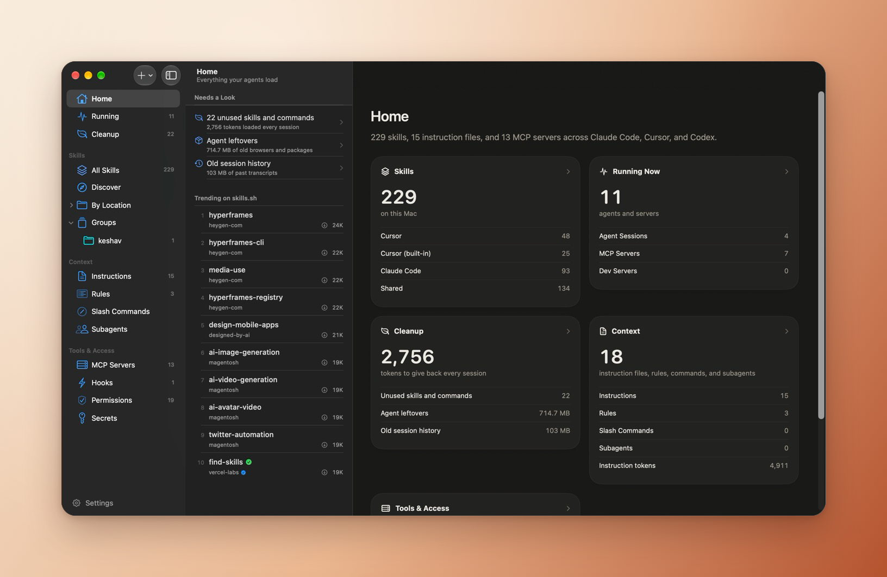
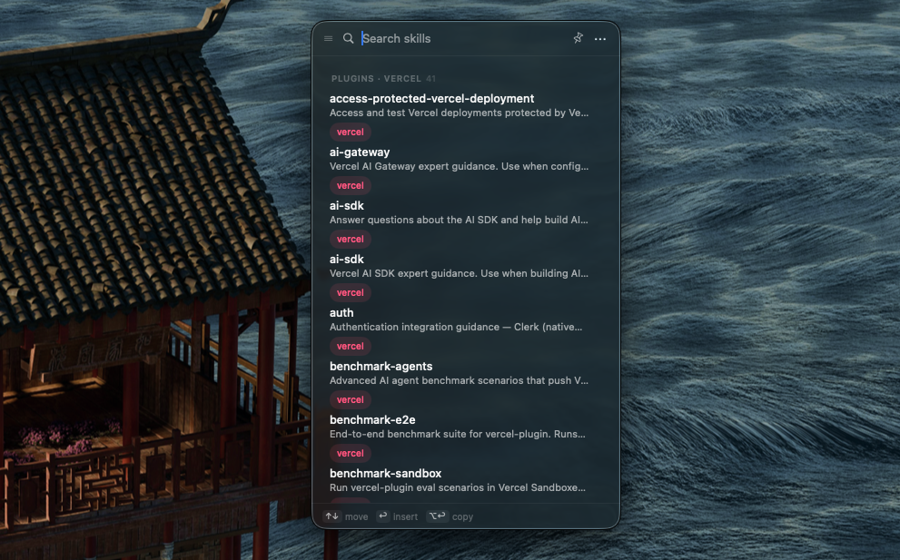
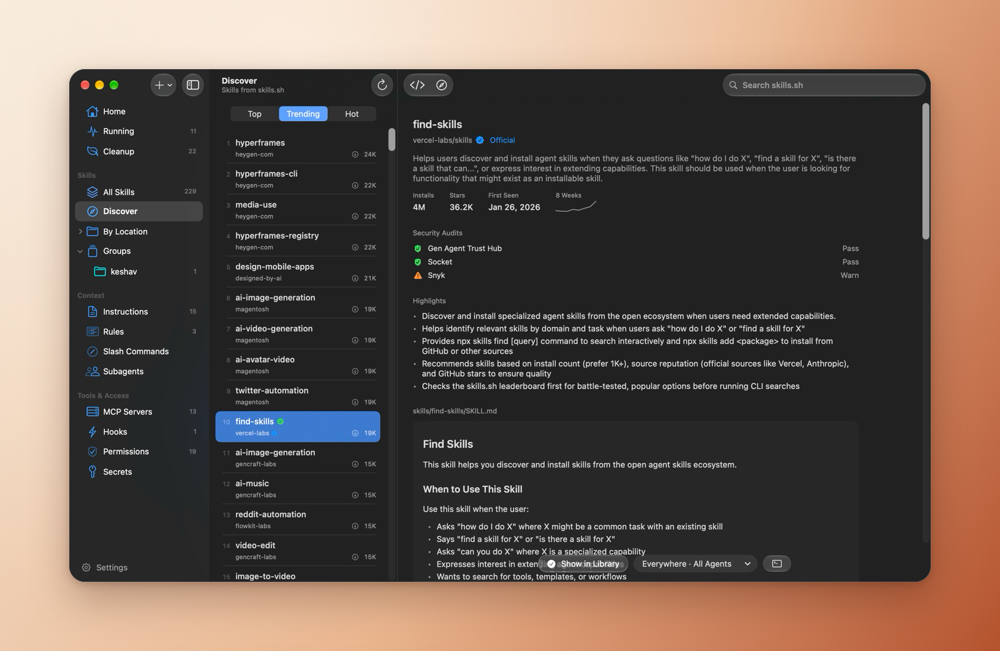
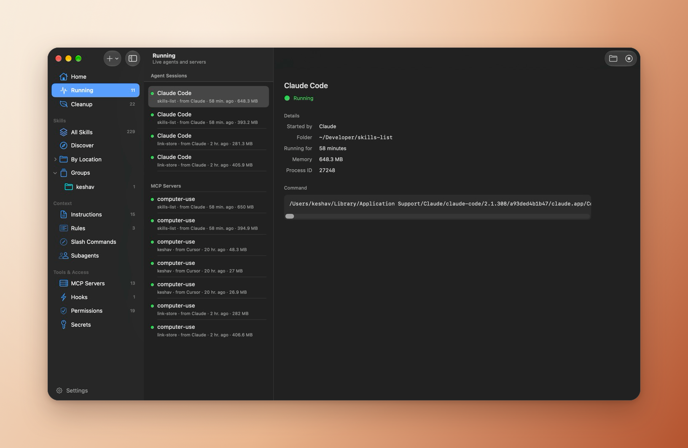
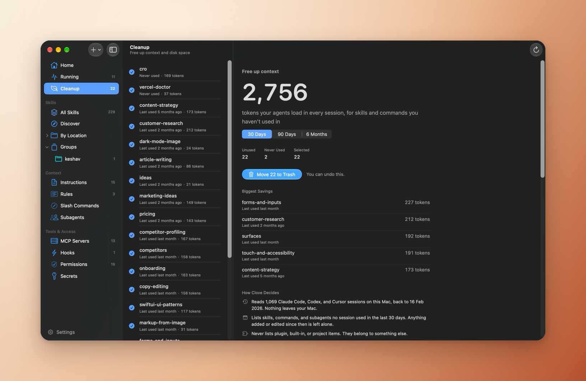
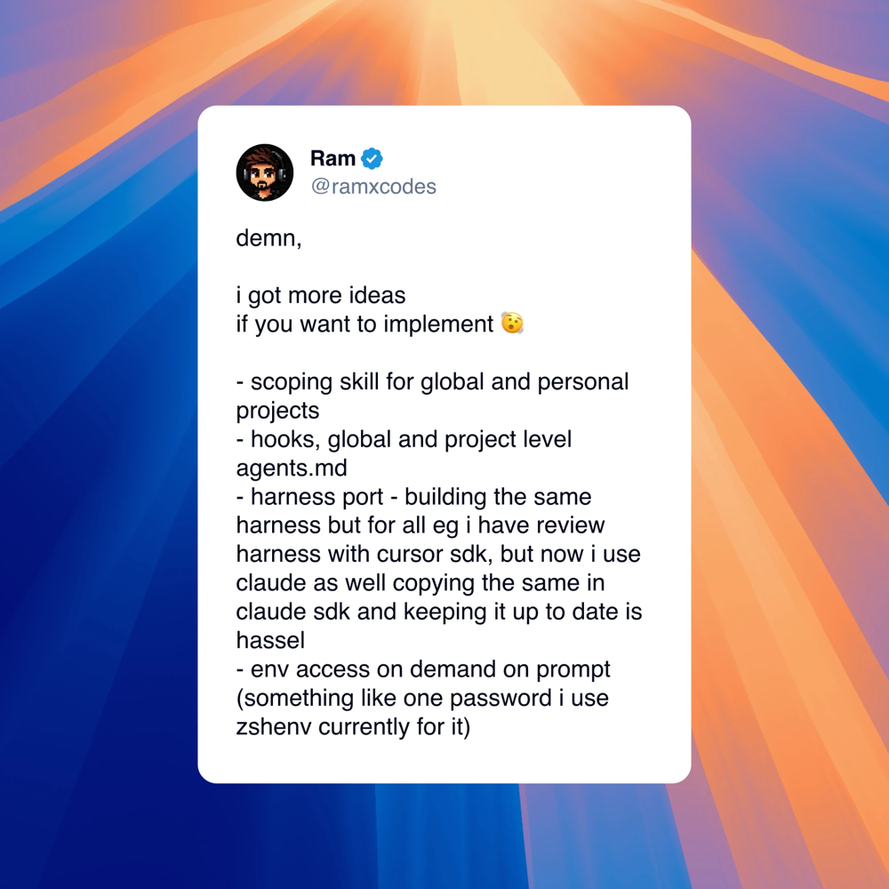

<div align="center">


# Clove

**Everything your AI agents load, in one native Mac app.**

Skills, instruction files, rules, commands, subagents, MCP servers, hooks, permissions, and the API keys they need, across Claude Code, Cursor, and Codex. Find new skills on [skills.sh](https://skills.sh), see what each agent is set up with, and clean out what you don't use.

[**Download for Mac**](https://github.com/keshav-exe/clove/releases/latest) · [Website](https://www.kshv.me/clove) · [What's new in 2.0](https://github.com/keshav-exe/clove/releases/tag/v2.0)

Free and open source · MIT · No account · macOS 26



</div>

## Home

One page with what needs a look right now: skills you never use, leftovers agents downloaded and forgot, old session history, keys sitting in plain text. Trending skills from skills.sh sit beside it, one click from their page.

## Quick access panel



Skills live in `~/.cursor`, `~/.claude`, plugins, and project folders. Clove finds every `SKILL.md` on your Mac, including skills linked in from a dotfiles repo, and puts them one shortcut away.

- Search names, descriptions, and groups
- Copy prompt-ready references like `/animations` or `@nextjs`, not file paths
- Pin the panel beside your editor (`⌘⇧K`), or drag a skill straight into a prompt
- Group skills and copy a whole stack at once

<br clear="right" />

## Discover



- Browse the skills.sh Top, Trending, and Hot lists, or search all of them
- Read a skill's SKILL.md, highlights, and security audits before installing
- Install in one click, everywhere or into one project. Clove puts one copy in `.agents/skills` and links it into the agents you pick, the same layout as `npx skills add`
- Check installed skills for updates and update them in place

## Context and tools

- **Instruction files:** `CLAUDE.md`, `AGENTS.md`, `GEMINI.md`, and Copilot instructions, globally and per project, with what each costs in context. Point several agents at one file and edit it once
- **Rules:** Cursor rules (`.cursor/rules/*.mdc`, `.cursorrules`), Windsurf rules, and Copilot instruction files, with when each applies
- **Commands and subagents** for Claude Code, Cursor, and Codex. Share one with another agent and Clove links it, so edits reach both
- **MCP servers** from Claude Code, Cursor, Codex, Gemini, Claude Desktop, and Windsurf. Add one to another agent in a click. Environment variables and headers show names only
- **Hooks** from Claude Code, Cursor, and Codex, with a warning when a hook's script is missing
- **Permissions:** Claude Code's allow and deny rules per project

## Secrets

- Keep API keys in your login Keychain instead of `~/.zshenv`
- Clove finds keys exported in plain text from your shell profiles and moves them, rewriting each line to read from the Keychain
- Copy a shell line or an MCP-safe command for any key. macOS asks before handing it to anything but Clove

## Running



Live agent sessions, the MCP servers they start, and the dev servers they leave behind. See what started each one, where it runs, and how much memory it holds. Stop the ones you're done with.

## Cleanup



- See which skills, commands, and subagents your agents haven't used in 30 days, 90 days, or 6 months, read from Claude Code, Codex, and Cursor history on your Mac
- See what they cost: every installed skill's description loads into each agent session
- Find leftovers like old Chrome for Testing builds, idle `npx` installs, and unused Claude Code versions
- Move it all to the Trash in one click, with undo

## Write

- Edit any SKILL.md with a live preview and checks against the Agent Skills format (`⌘E`)
- Start a new skill from a guide, workflow, or review template (`⌘N`)

## Install

1. Download the latest `.dmg` from [Releases](https://github.com/keshav-exe/clove/releases/latest)
2. Drag Clove into Applications
3. Open it and finish the short setup

Requires macOS 26 or later. Intel and Apple Silicon.

If Gatekeeper blocks the first launch: System Settings → Privacy & Security → Open Anyway.

## Build from source

```bash
git clone git@github.com:keshav-exe/clove.git
cd clove
open Clove.xcodeproj
```

Or from the command line:

```bash
xcodebuild -scheme Clove -configuration Release -destination 'platform=macOS' build
```

Xcode 26 and the macOS 26 SDK.

To ship a release (signed, notarized, tagged, and on GitHub Releases in one go):

```bash
./tools/release.sh 2.1 docs/release-notes/2.1.md
```

## Privacy

Skills never leave your Mac. Cleanup reads agent transcripts on your Mac only to find skill names, and keeps nothing but those names and dates. Clove changes skill files only when you install, edit, or remove one, and anything it replaces goes to the Trash. Groups are saved in one JSON file inside Application Support.

Clove shares `~/.agents/.skill-lock.json` with the [skills CLI](https://github.com/vercel-labs/skills), so skills installed either way show where they came from and can be updated by both.

Network calls: skills.sh and GitHub while you use Discover or install and update a skill, plus optional app update checks. Installing from Clove sends no telemetry, so those installs don't count toward the skills.sh leaderboard. No analytics. No account.

## Credits

Several 2.0 features came from [Ram (@ramxcodes)](https://x.com/ramxcodes/status/2113292890294423802): installing skills into one project, hooks and instruction files like AGENTS.md, sharing one setup across agents, and moving keys out of `~/.zshenv` into Secrets. Thank you.

<a href="https://x.com/ramxcodes/status/2113292890294423802"></a>

## License

[MIT](LICENSE)
